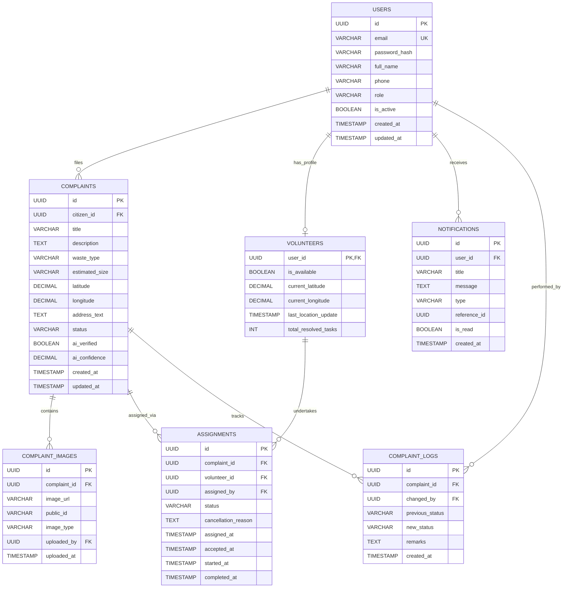
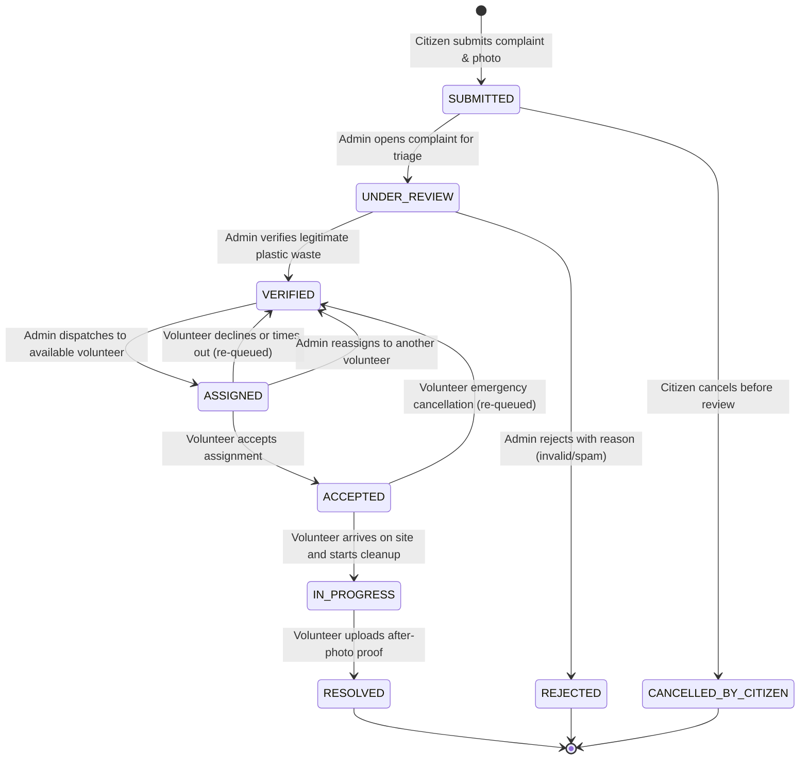

# System Architecture Document
## Plastic Waste Reporting and Volunteer Tracking System

---

## 1. Executive Summary & Objective

The **Plastic Waste Reporting and Volunteer Tracking System** is a full-stack, distributed platform designed to streamline community-driven environmental cleanup.
- **Citizens** report plastic waste hotspots using smartphone or web photos with geotagged locations.
- **Administrators** triage complaints, verify submissions, and dispatch tasks to nearby registered volunteers.
- **Volunteers** update their live availability, accept assignments, travel to the site, and upload timestamped proof of cleanup.
- **Citizens & Admins** track resolution progress transparently through an audit-backed state machine.

---

## 2. Technology Stack & Architectural Decisions

| Layer | Technology | Selection Rationale |
| :--- | :--- | :--- |
| **Frontend** | React 19 + Vite + JavaScript | Ultra-fast HMR, lightweight SPA footprint, modern reactive component model. |
| **Styling** | Vanilla CSS (CSS Modules & Custom Properties) | Maximum performance, zero runtime overhead, complete theme customization without third-party framework lock-in. |
| **Backend** | Java (JDK 24 runtime, Java 21 bytecode target) + Spring Boot 3.4.x + Maven | Robust enterprise architecture, strict type safety, dependency injection, and reliable relational transactions. |
| **Database** | PostgreSQL 18 | Strong ACID compliance, robust indexing, native JSONB support, and spatial query capability. |
| **Database Migrations** | Flyway | Strict version-controlled schema evolution; eliminates discrepancies between developer and production databases. |
| **Security** | Spring Security + Stateless JWT | Industry-standard role-based access control (RBAC), stateless sessions, and cryptographic request verification. |
| **Media Storage** | Cloudinary | CDN-accelerated image hosting, automated compression, transformation, and metadata tagging. |
| **Maps & Geolocation** | Leaflet + OpenStreetMap | Free, open-source cartography with zero API fees or usage quotas. |
| **AI Verification** | Python 3.14 + FastAPI (Decoupled microservice) | Independent scaling for machine learning inference without bloating the core Spring Boot application. |
| **API Testing** | Postman | Standardized integration test suites and exportable collection format. |

---

## 3. Monorepo Structure

```
plastic-waste-management/
│
├── .gitignore                      # Monorepo-wide exclusions (dependencies, build dirs, secrets)
├── README.md                       # Repository overview and quickstart guide
│
├── docs/                           # Architecture, database schemas, and documentation
│   ├── architecture.md             # This document (System architecture & technical spec)
│   ├── README.md                   # Service-by-service setup and execution instructions
│   └── postman/                    # Postman collection & environment JSON files
│
├── backend/                        # Java Spring Boot Maven service
│   ├── pom.xml                     # Maven build configuration & dependencies
│   ├── .env.example                # Template for backend environment variables
│   ├── .gitignore                  # Java/Maven specific ignore rules
│   └── src/
│       ├── main/
│       │   ├── java/com/waste/management/
│       │   │   ├── Application.java         # Spring Boot application entry point
│       │   │   ├── config/                  # Security, WebMvc, Cloudinary configs
│       │   │   ├── controller/              # REST API controllers
│       │   │   ├── dto/                     # Request and Response DTO records/classes
│       │   │   ├── entity/                  # JPA Database entities
│       │   │   ├── enums/                   # Role, ComplaintStatus, AssignmentStatus
│       │   │   ├── exception/               # GlobalExceptionHandler & custom exceptions
│       │   │   ├── repository/              # Spring Data JPA repositories
│       │   │   ├── security/                # JWT filters, UserDetailsService, Auth tokens
│       │   │   └── service/                 # Business logic and transaction workflows
│       │   └── resources/
│       │       ├── application.yml          # Spring configuration
│       │       └── db/migration/            # Flyway versioned migration scripts (V1, V2...)
│       └── test/                            # JUnit & Spring Boot test suite
│
├── frontend/                       # React + Vite client application
│   ├── package.json                # NPM dependencies and scripts
│   ├── vite.config.js              # Vite server & bundler settings
│   ├── index.html                  # HTML entry point
│   ├── .env.example                # Client-side configuration template
│   ├── .gitignore                  # Node/Vite specific ignore rules
│   └── src/
│       ├── main.jsx                # React DOM mount point
│       ├── App.jsx                 # Application routes & layout
│       ├── index.css               # Global design tokens, color palette, animations
│       ├── api/                    # API client layer (Axios/fetch wrappers)
│       ├── context/                # Global React contexts (AuthContext, AlertContext)
│       ├── components/             # Reusable UI elements (Navbar, MapView, Modal, Badge)
│       └── pages/                  # Views: Login, Register, Citizen, Admin, Volunteer
│
└── ai-service/                     # Python FastAPI AI verification microservice
    ├── requirements.txt            # Python dependencies (FastAPI, Uvicorn, Pydantic)
    ├── .env.example                # AI microservice environment template
    ├── .gitignore                  # Python specific ignore rules
    └── app/
        ├── main.py                 # FastAPI application & endpoints
        ├── api/                    # Microservice routers
        └── services/               # Model inference handlers
```

---

## 4. Database Entities & Relationships

### Entity Relationship Diagram



### Table Definitions & Design Decisions
1. **`users`**: Central account identity. Uses `UUID` primary keys for non-sequential, secure IDs. Enforces unique email constraint.
2. **`volunteers`**: Profile extension table for users with `role = 'VOLUNTEER'`. Separates volunteer operational status (availability, coordinates) from authentication identity.
3. **`complaints`**: Core report entity. Stores precise latitude and longitude coordinates for map rendering and spatial distance queries.
4. **`complaint_images`**: Supports multi-image reports. Uses `image_type` discriminator (`INITIAL_PROOF` for citizen reports, `RESOLUTION_PROOF` for volunteer cleanups).
5. **`assignments`**: Junction entity tracking the lifecycle of an admin dispatching a complaint to a volunteer. Maintains timestamp checkpoints (`assigned_at`, `accepted_at`, `started_at`, `completed_at`).
6. **`complaint_logs`**: Append-only audit ledger recording every status change, responsible actor, and reason.
7. **`notifications`**: User alerts for status updates, task dispatch, or cancellations.

---

## 5. User Roles & Access Control Matrix

| Feature / Action | CITIZEN | VOLUNTEER | ADMIN |
| :--- | :---: | :---: | :---: |
| Self-Registration & Login | ✅ | ✅ | ❌ *(Seeded / Admin promoted)* |
| Submit Waste Complaint | ✅ | ❌ | ❌ |
| View Own Complaints | ✅ | ❌ | ✅ *(All)* |
| Cancel Complaint *(Only when SUBMITTED)* | ✅ | ❌ | ✅ *(Any state)* |
| View Public Waste Map | ✅ | ✅ | ✅ |
| Toggle Availability & Broadcast GPS | ❌ | ✅ | ❌ |
| View Assigned Tasks | ❌ | ✅ | ✅ |
| Accept / Decline Assigned Task | ❌ | ✅ | ❌ |
| Start Task & Upload Resolution Proof | ❌ | ✅ | ❌ |
| Review & Triage Complaints | ❌ | ❌ | ✅ |
| Verify or Reject Complaint | ❌ | ❌ | ✅ |
| Query Nearby Volunteers & Dispatch | ❌ | ❌ | ✅ |
| Reassign Active Task | ❌ | ❌ | ✅ |

---

## 6. Complaint Lifecycle State Machine



### Transition Integrity & Safeguards
- **Reassignment Safeguard**: When an admin reassigns a task, the existing `ASSIGNMENT` is marked `CANCELLED`, an audit log entry is written, the prior volunteer's active task count is decremented, and the complaint returns to `VERIFIED` before new assignment creation.
- **Volunteer Declination**: If a volunteer declines within their response window, the complaint immediately resets to `VERIFIED` so it reappears on the admin dispatch radar.
- **Mandatory Rejection Reason**: A complaint cannot transition to `REJECTED` without an explicit rejection note recorded in `complaint_logs`.
- **Proof Required for Resolution**: The transition to `RESOLVED` requires a verified `RESOLUTION_PROOF` image uploaded to Cloudinary.

---

## 7. REST API Endpoints Specification

### 1. Authentication & Profiles (`/api/v1/auth`, `/api/v1/users`)
- `POST /api/v1/auth/register` — Citizen/Volunteer registration (Public)
- `POST /api/v1/auth/login` — Authenticate and receive JWT access token (Public)
- `GET /api/v1/users/me` — Retrieve current authenticated user profile (All Authenticated)
- `PUT /api/v1/volunteer/status` — Toggle volunteer availability and update GPS coordinates (`ROLE_VOLUNTEER`)

### 2. Complaints (`/api/v1/complaints`)
- `POST /api/v1/complaints` — Create a new waste report (`ROLE_CITIZEN`)
- `GET /api/v1/complaints/my` — Get reports filed by the calling citizen (`ROLE_CITIZEN`)
- `GET /api/v1/complaints` — Search and filter complaints with status/location filters (`ROLE_ADMIN`)
- `GET /api/v1/complaints/public-map` — Fetch sanitized complaints for public map (`Public / Authenticated`)
- `GET /api/v1/complaints/{id}` — Fetch complaint details and images (Authorized)
- `PATCH /api/v1/complaints/{id}/review` — Transition to `UNDER_REVIEW` (`ROLE_ADMIN`)
- `PATCH /api/v1/complaints/{id}/verify` — Transition to `VERIFIED` (`ROLE_ADMIN`)
- `PATCH /api/v1/complaints/{id}/reject` — Transition to `REJECTED` with required explanation (`ROLE_ADMIN`)
- `PATCH /api/v1/complaints/{id}/cancel` — Citizen cancels own report (`ROLE_CITIZEN`)

### 3. Assignments & Volunteer Workflow (`/api/v1/assignments`)
- `GET /api/v1/assignments/nearby-volunteers` — Query available volunteers within radius using Haversine formula (`ROLE_ADMIN`)
- `POST /api/v1/assignments` — Assign a verified complaint to a volunteer (`ROLE_ADMIN`)
- `POST /api/v1/assignments/{id}/reassign` — Reassign task to a different volunteer (`ROLE_ADMIN`)
- `GET /api/v1/assignments/my-tasks` — List tasks assigned to the current volunteer (`ROLE_VOLUNTEER`)
- `PATCH /api/v1/assignments/{id}/accept` — Accept task (`ROLE_VOLUNTEER`)
- `PATCH /api/v1/assignments/{id}/decline` — Decline task (`ROLE_VOLUNTEER`)
- `PATCH /api/v1/assignments/{id}/start` — Mark task `IN_PROGRESS` (`ROLE_VOLUNTEER`)
- `PATCH /api/v1/assignments/{id}/resolve` — Mark task `RESOLVED` with cleanup photo (`ROLE_VOLUNTEER`)

### 4. Media & Notifications (`/api/v1/media`, `/api/v1/notifications`)
- `POST /api/v1/media/upload` — Upload multipart image to Cloudinary (Authenticated)
- `GET /api/v1/notifications` — Fetch user notification list (Authenticated)
- `PATCH /api/v1/notifications/{id}/read` — Mark notification read (Authenticated)

---

## 8. Security & Environment Variable Management

### Spring Security RBAC Rules
- All endpoints under `/api/v1/auth/**` and public health checks `/api/v1/health` are unauthenticated (`permitAll()`).
- All other endpoints require a signed, non-expired Bearer JWT token.
- Granular method security enabled via `@EnableMethodSecurity`:
  - Citizen actions guarded with `@PreAuthorize("hasRole('CITIZEN')")`.
  - Volunteer actions guarded with `@PreAuthorize("hasRole('VOLUNTEER')")`.
  - Admin management guarded with `@PreAuthorize("hasRole('ADMIN')")`.
- Resource ownership verification ensures citizens can only edit or cancel their own reports.

### Environment Variables Template
```properties
# Backend
SERVER_PORT=8080
SPRING_DATASOURCE_URL=jdbc:postgresql://localhost:5432/plastic_waste_db
SPRING_DATASOURCE_USERNAME=postgres
SPRING_DATASOURCE_PASSWORD=your_secure_password
JWT_SECRET=your_256_bit_secret_key_minimum_32_characters_here
JWT_EXPIRATION_MS=86400000
CLOUDINARY_CLOUD_NAME=your_cloud_name
CLOUDINARY_API_KEY=your_api_key
CLOUDINARY_API_SECRET=your_api_secret
CORS_ALLOWED_ORIGINS=http://localhost:5173

# Frontend
VITE_API_BASE_URL=http://localhost:8080/api/v1

# AI Service
AI_SERVICE_PORT=8001
AI_SERVICE_HOST=0.0.0.0
```

---

## 9. Phased Development Roadmap

1. **Milestone 1: Project Scaffolding & Health Foundations (Current)**
   - Monorepo directory setup: `frontend/`, `backend/`, `ai-service/`, `docs/`.
   - React + Vite initialization with Leaflet and vanilla CSS tokens.
   - Spring Boot 3.4 setup on JDK 24 with `/api/v1/health`.
   - FastAPI initialization with `/health`.
   - Setup and architecture documentation.
2. **Milestone 2: Database Schema & JWT Authentication**
   - Flyway database migration `V1__init.sql`.
   - JPA entities (`User`, `VolunteerProfile`).
   - Spring Security JWT authentication and role validation.
3. **Milestone 3: Complaint Reporting & Cloudinary Integration**
   - Cloudinary upload service.
   - Complaint submission with geolocation coordinates.
   - Complaint lifecycle service and state machine audit logs.
4. **Milestone 4: Volunteer Tracking & Dispatch Engine**
   - Haversine distance spatial query for nearest volunteers.
   - Assignment dispatch, acceptance, declination, and reassignment.
5. **Milestone 5: Interactive Frontend Application**
   - Leaflet interactive map integration.
   - Citizen reporting flow.
   - Admin dispatch dashboard.
   - Volunteer mobile-friendly task view.
6. **Milestone 6: AI Microservice & End-to-End Testing**
   - FastAPI plastic waste computer vision model integration.
   - Complete Postman test collection with automated assertions.
